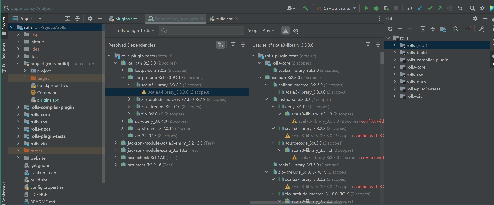

# Sbt Dependency Analyzer

[![Build Status][badge:build]][gh:workflows-build]
[![License][badge:license]][gh:license]
[![Downloads][badge:downloads]][plugin-homepage]

Inspect sbt dependency trees, trace version conflicts, and navigate to or edit dependency declarations in IntelliJ IDEA.

**English** | [中文](README-CN.md) · [Marketplace][plugin-homepage] · [Report an issue](https://github.com/bitlap/sbt-dependency-analyzer/issues)

## Features

- **Dependencies and usage paths**: Explore direct and transitive dependencies and their usages, filtered by module and scope.
- **Search and conflicts**: Find dependencies, inspect version conflicts, and trace how a dependency was introduced.
- **Module dependencies**: Distinguish sbt project IDs, published names and IDEA display names when analyzing multi-module, JVM, Scala.js and Scala Native projects.
- **Source navigation and edits**: Find declarations and preview direct dependency removal or transitive dependency exclusion.
- **JAR sizes**: Load sizes on demand and deduplicate resolved coordinates when calculating totals.

## Quick start

1. Install **Scala** and **Sbt Dependency Analyzer** from `Settings/Preferences → Plugins → Marketplace`.
2. Import an sbt project in IDEA and wait for project import and indexing to finish.
3. Press **Ctrl + Shift + L** on Windows, Linux or macOS, or use the sbt tool-window button or **Analyze sbt Dependencies** in a module's context menu.
4. Select a module and scope, then search dependencies or inspect their usage paths.

The first analysis generates `project/sdap.sbt` when needed to enable dependency graph tasks. Keep this generated file and reload sbt when prompted by the IDE.

## Common actions

Select a dependency in the list or tree and open its context menu:

| Action | Purpose |
| --- | --- |
| Go to Dependency | Navigate to the source declaration, or the introducing direct declaration for a transitive dependency; choose when several match. |
| Remove Direct Dependency | Preview removal of the selected direct dependency's use site. |
| Exclude from … | Preview exclusion of a transitive dependency from the selected direct declaration. |
| Refresh Dependencies | Invalidate graph caches and analyze again. |
| Refresh Snapshot Dependencies | Update the current module's SNAPSHOT dependencies in the background. |

Removal and exclusion are experimental. Review the diff with syntax and change highlighting before applying, or cancel; applying creates one undoable command. Reload sbt after an edit, then refresh the analysis.

Navigation resolves constants, dependency aliases and common dependency expressions. Shared `ModuleID` aliases are edited at their use sites where possible. Statically resolved shared ordered lists are edited at the current module’s reference using coordinates, configuration and cross version instead of list positions; computed declarations that cannot be located safely require manual edits. Exact versions take precedence; evicted or dynamic versions fall back to coordinate and scope candidates.

Analysis runs in the background, and failure notifications offer a retry action. Cancellation stops waiting; a submitted sbt command may continue running. Module and scope selectors support Enter; scope checkboxes also support Space.

## Settings 

Open `Settings/Preferences → Tools → Sbt Dependency Analyzer`:

| Setting | Description |
| --- | --- |
| File Cache Timeout | Seconds to reuse dependency graph data; defaults to `3600`. Set `0` to disable graph caching. |
| Organization override | Leave blank to read the current sbt module's setting, or supply an organization explicitly. |
| Disabled scopes | Skip Compile, Test or Provided analysis when not needed. |

Settings are saved per IDEA project. **Refresh Dependencies** immediately invalidates graph caches; closing the project releases in-memory caches.

## Troubleshooting

### Edits are not reflected in the dependency tree

Save the build file and reload sbt, then select **Refresh Dependencies**. Refreshing the analyzer alone does not make sbt reload the build definition.

### No source declaration is found, or editing is disabled

Wait for indexing and check the selected module and scope. Common modifiers, inherited configurations and shared ordered dependency lists are supported. Shared-list edits apply at the current module’s reference. Dynamic factories and unordered collections that cannot be located statically require a manual build-file edit.

### Module dependencies are not recognized

Finish sbt import and check the modules' `organization` settings. Set an [Organization override](#settings) if needed. Module-name discovery does not require membership in the root project's `aggregate` or `dependsOn`.

Builds loaded through sbt `RootProject` or `ProjectRef` can be analyzed in the same sbt shell. The analyzer uses each project’s build URI and ID, keeping same-named projects in different builds separate. Independently linked builds that the active shell has not loaded should be opened in separate IDEA projects.

### “Could not create lock for …”

Wait for any active import or build to finish, then use `reload` or `compile` in IDEA's sbt shell. Avoid concurrent operations on the same build.

## Development and validation

See [CONTRIBUTING.md](CONTRIBUTING.md) for builds, tests, sandbox launch and release instructions. The [validation record](docs/md/validation/README.md) contains performance measurements, PSI regression results and test boundaries.

[Issues](https://github.com/bitlap/sbt-dependency-analyzer/issues) and pull requests are welcome. Thanks to [JetBrains](https://www.jetbrains.com/) for supporting development tools.

[badge:build]: https://github.com/bitlap/sbt-dependency-analyzer/actions/workflows/ScalaCI.yml/badge.svg
[badge:license]: https://img.shields.io/github/license/bitlap/sbt-dependency-analyzer.svg?style=flat-square
[badge:downloads]: https://img.shields.io/jetbrains/plugin/d/22427.svg?style=flat-square&colorB=5C6BC0
[gh:workflows-build]: https://github.com/bitlap/sbt-dependency-analyzer/actions/workflows/ScalaCI.yml
[gh:license]: https://github.com/bitlap/sbt-dependency-analyzer/blob/master/LICENSE
[plugin-homepage]: https://plugins.jetbrains.com/plugin/22427-sbt-dependency-analyzer
